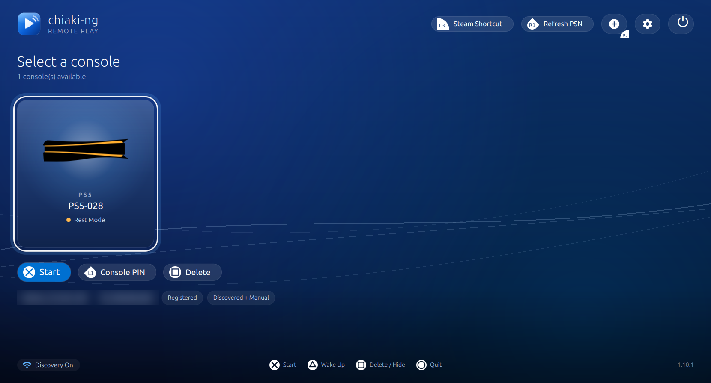
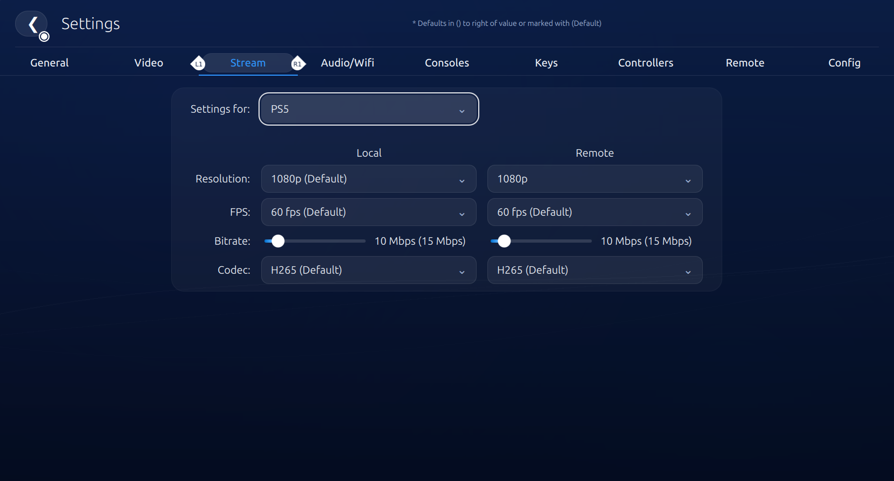
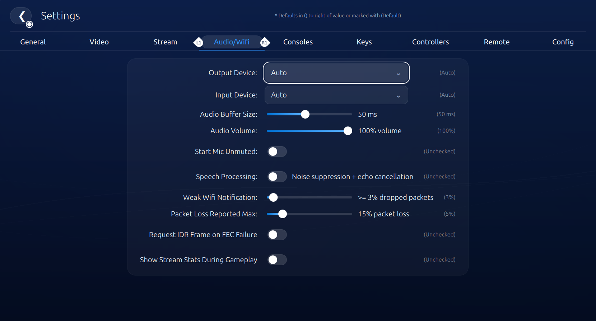
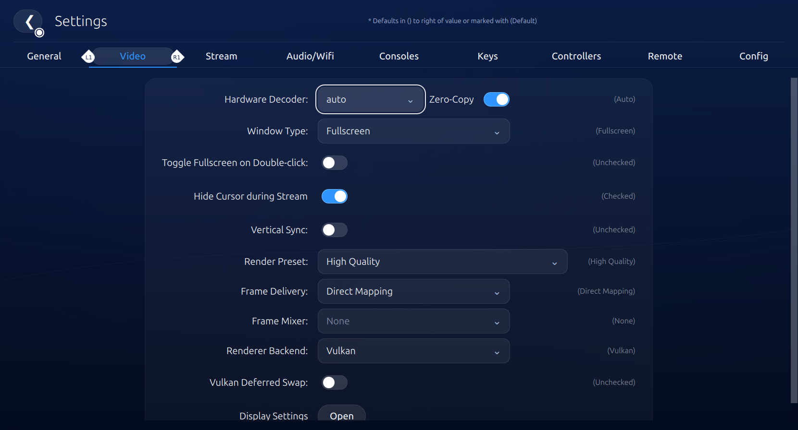

<p align="center">
  
</p>

<h1 align="center">Remote Play</h1>

<p align="center">
  A redesigned build of <a href="https://github.com/chiaki-ng/chiaki-ng">chiaki-ng</a>, the open-source Remote Play client for PS4 and PS5.<br>
  It has a console-style interface, smooth animations, a new logo and settings tuned for stable 1080p / 60 fps streaming.
</p>

<p align="center">
  <b>Windows</b> · <b>macOS</b> · <b>Linux</b>
</p>

<p align="center">
  
</p>

---

## What's different from chiaki-ng

The streaming engine is unchanged chiaki-ng. Everything you see on screen has been redesigned:

| Area | Change |
|---|---|
| **Home screen** | Console cards in a horizontal carousel with live status (Ready / Rest Mode), a details panel with Start, Wake Up, Console PIN and Delete, and a controller button legend at the bottom |
| **Look** | Deep-blue gradient backdrop with soft glows and light ribbons. It plays a short intro animation and then stays still, so it doesn't redraw while you play |
| **Buttons & controls** | Rounded pill buttons, round icon buttons, toggle switches, sliders, combo boxes and text fields, each with a clear white focus ring for controller navigation |
| **Dialogs** | Spring-in pop-ups with a dimmed background |
| **Settings** | Every tab redesigned: a sliding tab highlight, fade between tabs, and options grouped on cards |
| **Connecting / loading** | Animated logo while connecting and while the stream starts |
| **In-game stats** | Small HUD in the top-left corner while you play: FPS, resolution, packet loss and bitrate, colour-coded green / yellow / red. Fully transparent, on by default; turn it off with *Settings → Audio/Wifi → Show FPS / Stats While Playing*. Drawn inside the stream, with no pop-up window |
| **Logo & app icon** | New logo, used for the Windows `.exe` and installer, the macOS `.app` / `.dmg` and the Linux icon |

All keyboard and controller shortcuts work as before. **Left / Right** now move between consoles on the home screen.

## Screenshots

| Stream | Audio / Wi-Fi | Video |
|---|---|---|
|  |  |  |

---

## Download

👉 **[Latest release](../../releases/latest)**: pick the file for your system:

| System | File |
|---|---|
| **Windows 10 / 11** | `RemotePlay-…-Windows-Setup.exe` (installer) or `…-Windows-Portable.zip` |
| **macOS 15+ on Apple Silicon** (M1 / M2 / M3 / M4) | `RemotePlay-…-macOS-AppleSilicon.dmg` |
| **Linux** (x86-64) | `RemotePlay-…-Linux-x86_64.AppImage` |

### Making a new release

Create and push a version tag. The **Release (Windows, macOS, Linux)** workflow builds all three and publishes them:

```bash
git tag v1.10.1-rp2
git push origin v1.10.1-rp2
```

You can also run that workflow from the **Actions** tab and type the tag name.

### Test builds without a release

1. Open the **[Actions](../../actions)** tab.
2. Pick a workflow on the left and click **Run workflow** → `main`:

   | You want | Run this workflow | You get |
   |---|---|---|
   | Windows 10 / 11 | **Build chiaki-ng Windows x86_64 (VC)** | `.exe` installer + portable `.zip` |
   | macOS 15 or newer (Apple Silicon) | **Build chiaki-ng macOSX** | `.dmg` |
   | Linux (x86-64) | **Build chiaki-ng Appimage x86_64** | `.AppImage` |

3. When the run finishes (about 20–40 minutes), download the file from **Artifacts** at the bottom of the run page. It comes zipped.

### First launch

The builds are not code-signed, so your system will warn you the first time:

- **Windows:** SmartScreen shows "Windows protected your PC". Click **More info** → **Run anyway**.
- **macOS:** drag the app to Applications, then **right-click → Open** the first time, or allow it under **System Settings → Privacy & Security**.
- **Linux:** make the AppImage executable and run it:
  ```bash
  chmod +x chiaki-ng*.AppImage
  ./chiaki-ng*.AppImage
  ```

### First-time setup

1. Turn on **Remote Play** on the console: *Settings → System → Remote Play → Enable Remote Play*.
2. Start the app. Consoles on the same network show up automatically. If yours doesn't, press **+** and type its IP address.
3. Select the console and press **Start**. The first time, the app asks you to register: get the PIN from *Settings → System → Remote Play → Link Device* on the console.
4. Press **Start** (✕ on a controller) to play.

---

## Recommended settings for smooth play

The Remote Play protocol goes up to **1080p at 60 fps**. These settings give the most stable picture on Wi-Fi:

| Setting | Where | Value | Why |
|---|---|---|---|
| Resolution | Settings → Stream | **1080p** | Full resolution |
| FPS | Settings → Stream | **60 fps** | Full frame rate |
| Bitrate | Settings → Stream | **10 Mbps** on Wi-Fi, **15 Mbps** on cable | Lower = fewer packets to lose = fewer glitches. Raise it if the picture looks blocky and the connection is clean |
| Codec | Settings → Stream | **H265** | Best quality per Mbps |
| Renderer Backend | Settings → Video | **Vulkan** | Fixes a blank window on some Linux / Intel setups |
| Render Preset | Settings → Video | **Default** or **Fast** on integrated graphics | High Quality can drop frames on weaker GPUs |
| Request IDR Frame on FEC Failure | Settings → Audio/Wifi | **Off** | Avoids short freezes when a packet can't be repaired |
| Packet Loss Reported Max | Settings → Audio/Wifi | **15%** | Lets the console lower the bitrate during bad Wi-Fi moments instead of stuttering |
| Show FPS / Stats While Playing | Settings → Audio/Wifi | **On** (default) | Shows the small FPS / resolution / packet-loss HUD while you play |

## Network tips

Nearly all lag and freezing comes from the network, not the app. In order of impact:

1. **Use a cable** for the console, the PC, or both. A wired console makes the biggest difference.
2. **On Wi-Fi, use 5 GHz**, not 2.4 GHz. Stay close to the router with few walls in between.
3. **Pick a quiet channel.** On the router, choose a 5 GHz channel no neighbour uses, at 40 or 80 MHz width.
4. **Turn off Wi-Fi power saving on the PC.** It adds sudden lag spikes.
   - Linux (NetworkManager): `nmcli connection modify "<your Wi-Fi name>" 802-11-wireless.powersave 2`, then reconnect.
   - Windows: Device Manager → your Wi-Fi adapter → Power Management → untick *Allow the computer to turn off this device*. Set the power plan to *High performance*.
5. **Different buildings or subnets:** if the console isn't found automatically, add it by IP with **+**. It still counts as a local connection.
6. **Remote play over the internet** works through PSN. Expect lower quality than at home, and use the "Remote" column in Settings → Stream for a lower bitrate there.

To check your connection, turn on **Show Stream Stats**, play for a few minutes, and watch the HUD in the top-left corner. Under about 1% is great. A few percent is normal on Wi-Fi. Spikes above 10% mean the network needs one of the fixes above.

---

## Building from source

The build is the same as upstream chiaki-ng. The new UI files are compiled into the app, so nothing extra is needed.

```bash
git clone --recurse-submodules https://github.com/codezardasht/remote-play.git
cd remote-play
```

Then follow the chiaki-ng build guide for your platform: <https://chiaki-ng.github.io/chiaki-ng/>.
The GitHub Actions workflows in [`.github/workflows`](.github/workflows) show the exact build steps for each platform.

### Where the UI lives

| Path | What |
|---|---|
| `gui/src/qml/MainView.qml` | Home screen |
| `gui/src/qml/PSBackground.qml` | Animated backdrop |
| `gui/src/qml/PSButton.qml`, `PSIconButton.qml`, `PSDialog.qml` | Shared buttons and dialogs |
| `gui/src/qml/controls/` | Restyled toggles, sliders, combo boxes, text fields |
| `gui/src/qml/SettingsDialog.qml` | Settings |
| `gui/src/qml/qtquickcontrols2.conf` | Theme colours |
| `gui/src/qml/images/logo.svg` | Logo |
| `gui/chiaking.ico` / `.icns` / `.png` | App icons |

---

## Credits

- **[chiaki-ng](https://github.com/chiaki-ng/chiaki-ng)** by Street Pea and contributors: the streaming engine and everything under the UI.
- **[Chiaki](https://git.sr.ht/~thestr4ng3r/chiaki)** by Florian Märkl: the original project.

## License

[GNU AGPL v3](COPYING), the same license as chiaki-ng. If you share builds of this app with other people, you must also give them access to the source code.

## Disclaimer

This project is not endorsed or certified by Sony Interactive Entertainment LLC. "PlayStation", "PS4" and "PS5" are trademarks of Sony Interactive Entertainment Inc. This is an unofficial, independent client.
